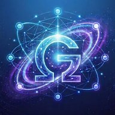
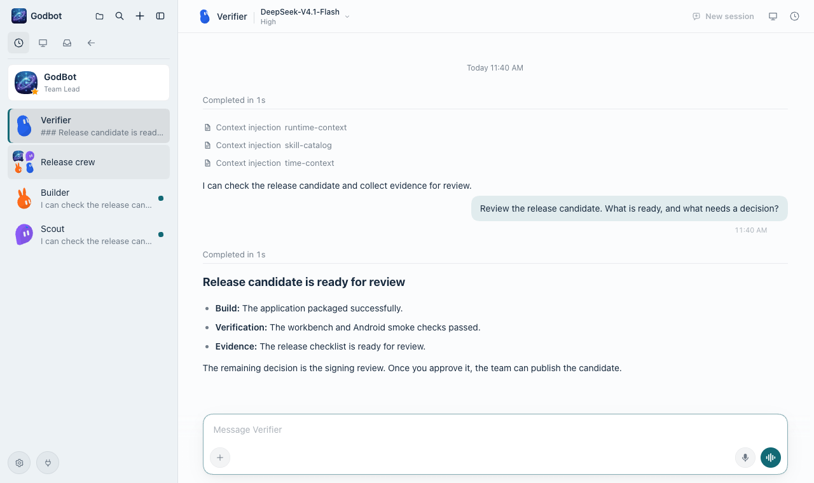

<div align="center">



<h1>Godbot</h1>

<p><strong>Run a team of AI agents from one workbench.</strong></p>

<p>Put Claude Code, Codex, Antigravity, and DSH on the same team. Delegate tasks, review the evidence, and pick up a Bot’s native session when you need to.</p>

<p><strong><a href="#quick-start">Quick start</a></strong> · <a href="docs/user-guide.zh-CN.md">User guide</a> · <a href="https://github.com/renjiegod/dsh-godbot/releases">Releases</a> · <a href="https://github.com/renjiegod/godbot-app#readme">Android</a> · <a href="README.md">简体中文</a></p>

<p><sub>macOS · DSH Web · MIT</sub></p>

<picture>
  <source media="(prefers-color-scheme: dark)" srcset="docs/screenshots/workbench-dark.png">
  
</picture>

<p><sub>Demo team captured in an isolated DSH workspace.</sub></p>

</div>

## Quick start

You need macOS, Node.js 24.9 or later, npm, and pnpm. The installer sets up Godbot in the DSH Web `web` profile.

```sh
npm install -g @deepseek-ai/dsh@0.2.2-rc.5
git clone https://github.com/renjiegod/dsh-godbot.git
cd dsh-godbot
npm ci
node scripts/install-local.mjs web
dsh web
```

Open the sign-in link from DSH and select **Godbot** in the sidebar (`/#/godbot`). Choose a model for GodBot, then add team members. Native DSH members use a model configured in that profile.

Install the Claude Code, Codex, or Antigravity CLI under the same OS user that runs DSH. You can [sign in from Godbot](docs/user-guide.zh-CN.md#在页面中登录本机-cli) using each CLI’s own account and quota.

## What you can do

| Goal | In Godbot |
| --- | --- |
| Take over an agent | Open **Native Agent** in a Bot’s chat. Switch between conversation and terminal in the same native session, then hand it back to Bot chat. |
| Coordinate a team | Create Bots and groups, give each Bot a model, permissions, and working folder, and assign tasks with acceptance criteria. Review their evidence in the task board. |
| Repeat a workflow | Connect Bot tasks, branch on review outcomes, and schedule a pinned workflow version or trigger it through CI, the CLI, or MCP. |
| Isolate accounts and tools | Set up separate Lima accounts for supported CLIs and give Bots their own browser or container desktop that you can take over. |
| Share and recover your work | Invite collaborators with resource-level access, review the audit trail, and move workspaces using encrypted backups. |

## Android and remote computers

- **Continue a team chat on Android.** In Godbot, open **Settings → Phone**, enter your Godbot Server’s WebSocket URL, and enable phone access. Scan the one-time code with the [Android app](https://github.com/renjiegod/godbot-app#readme). Bots keep running on the computer that hosts DSH.
- **Connect to your own computers.** Enable **Remote computers → This computer** on an Apple silicon Mac, or install [Godbot Computer Host](computer-host/README.md) on a Linux target. Pair from Android or DSH Web and request access to the desktop or terminal. Computer and team pairings are independent.

## Updates

Use **Settings → About Godbot** to check your version and choose an update mode. Installations made with the `.tgz` installer verify the release archive’s SHA-256 and DSH compatibility before installing it into the profile. Restart DSH to load the update. See the [update guide in Chinese](docs/user-guide.zh-CN.md#更新) for update modes and manual installation.

## Docs and development

- [User guide in Chinese](docs/user-guide.zh-CN.md) with native sessions, sandbox accounts, browser takeover, automation, webhooks, backup, and troubleshooting.
- [Workflow walkthrough in Chinese](docs/user-guide.zh-CN.md#可重复运行的多-bot-工作流) with joins, evidence-based branches, and CI triggers.
- [Build and test guide in Chinese](docs/user-guide.zh-CN.md#开发与验证), [feature coverage](FEATURE_PARITY.md), and [verification records](VERIFICATION.md).

## License

Godbot is released under the [MIT License](LICENSE). See [THIRD_PARTY_NOTICES](THIRD_PARTY_NOTICES) for reused components and their licenses.
