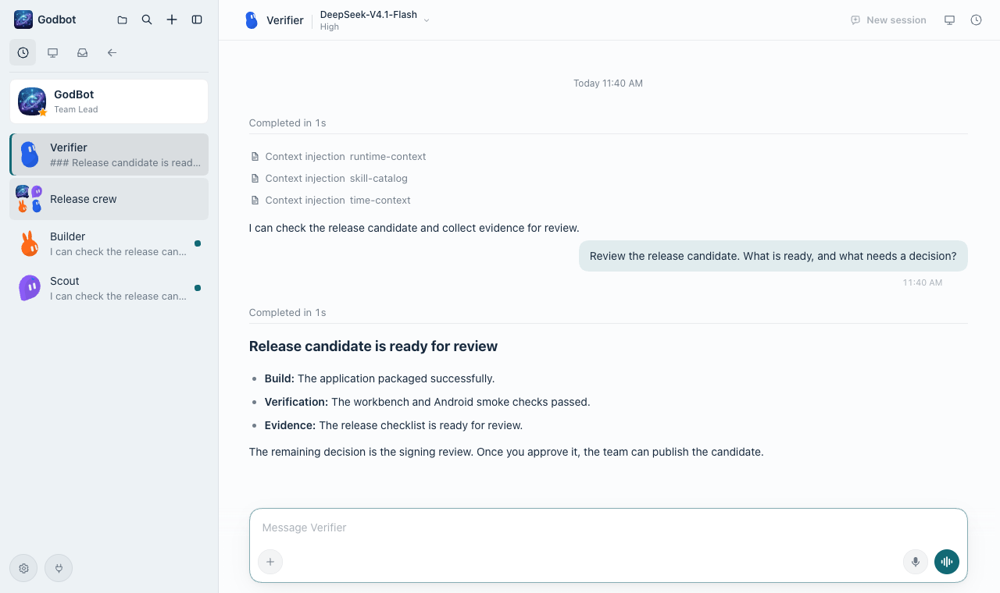

<div align="center">


<h1>Godbot</h1>

<p><strong>在一个工作台里协作，把任务交给不同的 Agent。</strong></p>

<p>让 Claude Code、Codex、Antigravity 和 DSH 组成一个团队。分配任务、验收交付，需要时直接接手 Bot 的原生会话。</p>

<p><strong><a href="#快速开始">快速开始</a></strong> · <a href="docs/user-guide.zh-CN.md">使用指南</a> · <a href="https://github.com/renjiegod/dsh-godbot/releases">发布版本</a> · <a href="https://github.com/renjiegod/godbot-app#readme">Android</a> · <a href="README.en.md">English</a></p>

<p><sub>macOS 和 Linux · DSH Web · MIT</sub></p>

<picture>
  <source media="(prefers-color-scheme: dark)" srcset="docs/screenshots/workbench-dark.png">
  
</picture>

<p><sub>在隔离的 DSH 工作区中截取的演示团队。</sub></p>

</div>

## 快速开始

Godbot 工作台可在 macOS 和 Linux 上运行。需要 Node.js 24.9 或以上、npm 和 pnpm，以及 DSH `0.2.2-rc.2` 或该系列的更新版本。已有兼容的 DSH 可以直接安装插件。

首次安装 DSH 和 pnpm 时，可以运行 `npm install -g @deepseek-ai/dsh@0.2.2-rc.5 pnpm@11.1.2`。

```sh
git clone https://github.com/renjiegod/dsh-godbot.git
cd dsh-godbot
npm ci
node scripts/install-local.mjs web
dsh web
```

用 DSH 提供的登录入口打开网页，点击侧栏的 **Godbot**（`/#/godbot`）。为 GodBot 选择模型，再新建团队成员。原生 DSH 成员需要该 profile 中配置可用的模型。

无桌面的 Linux 主机可用 `dsh web --no-open` 启动。

如果安装后提示 `This DSH profile uses a separate copy`，请按步骤修复原 profile 的依赖链接。[安装故障排查](docs/user-guide.zh-CN.md#安装后提示-dsh-依赖有两份)

Claude Code、Codex 和 Antigravity 使用本机 CLI。将需要的 CLI 安装在运行 DSH 的同一系统用户下。可以在 [Godbot 中登录 CLI](docs/user-guide.zh-CN.md#在页面中登录本机-cli)，沿用 CLI 自己的账号与配额。

## 在工作台里可以做什么

| 场景 | 操作 |
| --- | --- |
| 接手 Agent | 在 Bot 私聊里打开 **原生 Agent**，在同一会话内切换原生对话与终端。处理好后交还 Bot 聊天。 |
| 组织团队 | 创建 Bot 与群聊，为 Bot 设置工作目录、模型和权限。为任务写验收条件，在任务板查看 Bot 提交的证据。 |
| 重复运行一套流程 | 用工作流连接多个 Bot 的任务，按验收结果分支。绑定流程版本后定时运行，或从 CI、CLI 和 MCP 触发。 |
| 隔离账号与执行环境 | 为支持的 CLI 配置独立的 Lima 沙箱账号，为 Bot 开启独立浏览器或容器桌面，并按需接管。 |
| 与同事协作 | 按资源邀请同事查看、聊天或审批。通过审计记录查看操作，用加密备份迁移工作区。 |

## 手机与远程电脑

- **在 Android 上继续团队对话。** 在 Godbot 的 **设置 → 手机** 填入 Godbot Server 的 WebSocket 地址，开启手机访问，再用 [Godbot Android App](https://github.com/renjiegod/godbot-app#readme) 扫描一次性配对码。Bot 在原来的 DSH 电脑上运行。
- **从 Web 或 Android 访问自己的电脑。** 在 Apple 芯片 Mac 的 **远程电脑 → 本机** 开启访问，或在目标 Linux 机器安装 [Godbot Computer Host](computer-host/README.md)。配对后可查看获准的桌面或打开终端。电脑访问与团队配对各自授权。

## 更新

在 **设置 → 关于 Godbot** 查看版本、检查更新和选择更新方式。通过安装脚本安装的 `.tgz` 版本会校验 GitHub 发布包的 SHA-256 和 DSH 兼容性，再按设置安装到 profile。重启 DSH 后载入新版。详见[更新设置与手动更新](docs/user-guide.zh-CN.md#更新)。

## 文档与开发

- [Godbot 使用指南](docs/user-guide.zh-CN.md)涵盖原生会话、沙箱账号、浏览器接管、自动化、Webhook、备份和故障排查。
- [工作流示例](docs/user-guide.zh-CN.md#可重复运行的多-bot-工作流)演示汇合、按证据分支和从 CI 运行。
- [开发与验证](docs/user-guide.zh-CN.md#开发与验证)说明源码构建、本地测试和发布候选包的验证。
- [功能对照与验收范围](FEATURE_PARITY.md)与[验证记录](VERIFICATION.md)提供实现和测试参考。

## 许可证

Godbot 采用 [MIT 许可证](LICENSE)。第三方组件沿用各自的许可证，出处与修改范围见 [THIRD_PARTY_NOTICES](THIRD_PARTY_NOTICES)。
